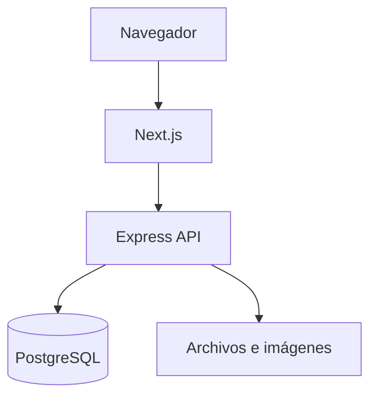

# Ludoteca Virtual — Arquitectura de Aplicación

**Estado:** Baseline arquitectónico v1.2  
**Fecha:** 19 de septiembre de 2026  
**Stack base:** Express 5 + TypeScript, Next.js App Router, PostgreSQL, Drizzle ORM, Zod 4 y npm workspaces  
**Estilo:** Monolito modular en monorepo

## 1. Propósito

Este documento define las reglas arquitectónicas iniciales de Ludoteca
Virtual. Su objetivo es mantener alineados el backend, el frontend y la base de
datos durante la implementación.

Complementa estos documentos:

- `ludoteca_virtual_dominio_reglas.md`;
- `ludoteca_virtual_erd_postgresql.sql`;
- `ludoteca_virtual_seed_system.sql`;
- `ludoteca_virtual_erd_notas.md`.

Si una decisión técnica contradice una regla funcional, primero debe revisarse
el documento de dominio. El código no debe redefinir silenciosamente el
negocio.

---

## 2. Decisiones arquitectónicas confirmadas

1. El backend se implementará con **Express 5 y TypeScript**.
2. El frontend se implementará con **Next.js usando App Router**.
3. PostgreSQL será la fuente de verdad persistente.
4. La aplicación comenzará como un **monolito modular**.
5. Backend y frontend estarán separados por una API HTTP.
6. Express será el único propietario de las reglas de negocio.
7. Next.js no accederá directamente a PostgreSQL.
8. Los módulos se organizarán por dominio y no solamente por tipo técnico.
9. Las operaciones que modifiquen varios registros relacionados utilizarán
   transacciones PostgreSQL.
10. Permisos globales y acceso al recurso concreto se validarán por separado.
11. El acceso tipado a PostgreSQL se implementará con **Drizzle ORM** sobre el
    driver `pg` (`node-postgres`).
12. Los contratos HTTP y la validación de datos no confiables se implementarán
    con **Zod 4**.
13. El monorepo se administrará inicialmente con **npm workspaces**, sin una
    capa adicional de orquestación.

No se adoptarán microservicios mientras el volumen, el equipo o las necesidades
de despliegue no proporcionen una razón medible para hacerlo.

---

## 3. Vista general



Responsabilidades:

| Componente | Responsabilidad principal |
|---|---|
| Next.js | Renderizado, navegación, interacción, formularios y experiencia de usuario |
| Express | Autenticación, autorización, reglas de negocio, transacciones y API |
| PostgreSQL | Integridad, relaciones, históricos y persistencia |
| Almacenamiento de archivos | Imágenes, adjuntos y recursos binarios; estrategia pendiente |

---

## 4. Organización del monorepo

Estructura inicial recomendada:

```text
ludoteca-virtual/
├── apps/
│   ├── api/                 # Express + TypeScript
│   └── web/                 # Next.js App Router
├── packages/
│   ├── contracts/           # Contratos compartidos y tipos públicos
│   ├── config/              # Configuración compartida de herramientas
│   └── test-utils/          # Utilidades de prueba reutilizables
├── docs/
├── package.json
└── README.md
```

El `package.json` raíz será privado y declarará:

```json
{
  "private": true,
  "workspaces": [
    "apps/*",
    "packages/*"
  ]
}
```

### Gestión con npm workspaces

- Existirá un solo `package-lock.json` en la raíz.
- Las instalaciones reproducibles se realizarán desde la raíz mediante
  `npm ci`.
- Una dependencia específica se instalará indicando su workspace, por ejemplo
  `npm install zod -w @ludoteca/contracts`.
- Los scripts compartidos podrán ejecutarse con `npm run <script> --workspaces
  --if-present`.
- Cada workspace seguirá declarando únicamente sus dependencias reales.
- No se importará código mediante rutas relativas que atraviesen workspaces;
  se utilizará el nombre declarado del paquete.
- Inicialmente no se añadirá Turborepo, Nx ni otro orquestador. Se reconsiderará
  si tiempos de build, caché o coordinación de tareas se convierten en un
  problema medible.

### Reglas del monorepo

- `apps/api` puede depender de `packages/contracts`.
- `apps/web` puede depender de `packages/contracts`.
- `packages/contracts` no puede depender de `apps/api` ni `apps/web`.
- El frontend no puede importar repositories, modelos internos de persistencia
  ni servicios del backend.
- Compartir TypeScript no significa compartir lógica de negocio.
- Los paquetes compartidos deben tener una responsabilidad explícita; no se
  creará un paquete `utils` genérico sin límites.

---

## 5. Backend Express

### 5.1 Organización por módulos de dominio

```text
apps/api/src/
├── modules/
│   ├── auth/
│   ├── users/
│   ├── groups/
│   ├── collections/
│   ├── catalog/
│   ├── matches/
│   ├── transactions/
│   ├── moderation/
│   ├── sharing/
│   └── audit/
├── infrastructure/
│   ├── database/
│   ├── files/
│   ├── logging/
│   └── clock/
├── middleware/
├── config/
├── errors/
├── app.ts
└── server.ts
```

Los nombres internos podrán ajustarse al lenguaje definitivo del producto,
pero los límites funcionales deben mantenerse explícitos.

### 5.2 Estructura de un módulo

```text
collections/
├── collection.routes.ts
├── collection.controller.ts
├── collection.service.ts
├── collection.repository.ts
├── collection.schemas.ts
├── collection.types.ts
└── collection.errors.ts
```

No todos los módulos están obligados a contener todos los archivos. Se crean
cuando exista una responsabilidad real.

### 5.3 Flujo de una solicitud

```text
Route → Middleware → Controller → Service → Repository → PostgreSQL
```

#### Route

- Declara método y URL.
- Conecta middleware y controller.
- No implementa reglas de negocio.

#### Middleware

- Autentica solicitudes.
- Comprueba permisos globales.
- Gestiona concerns HTTP transversales.
- No decide por sí solo ownership complejo.

#### Controller

- Traduce HTTP a una operación de aplicación.
- Obtiene parámetros, body y contexto autenticado ya validados.
- Invoca un service.
- Devuelve el código y cuerpo HTTP correspondientes.
- No ejecuta SQL ni contiene reglas de negocio.

#### Service

- Implementa casos de uso y reglas de negocio.
- Valida acceso al recurso concreto.
- Coordina repositories y otros servicios de dominio.
- Controla transacciones.
- No depende de objetos `Request` o `Response` de Express.

#### Repository

- Encapsula consultas y persistencia.
- No decide permisos ni reglas de negocio.
- No devuelve respuestas HTTP.
- Debe aceptar el contexto transaccional cuando el caso de uso lo requiera.

---

## 6. Reglas de dependencias entre módulos

1. Un controller solo llama servicios de aplicación.
2. Un service no importa controllers ni routes.
3. Un repository no importa services.
4. Un módulo no consulta directamente las tablas propiedad de otro módulo si
   eso evita una regla de negocio relevante.
5. Las operaciones entre módulos se realizan mediante servicios públicos o
   interfaces explícitas.
6. Se permiten consultas de lectura optimizadas entre varias tablas cuando no
   modifiquen estado ni eviten autorización; deben quedar aisladas como queries.
7. Las dependencias circulares entre módulos no son aceptables. Si aparecen,
   debe revisarse el límite del dominio o introducirse un servicio orquestador.

Ejemplo: `transactions` puede coordinar una venta, pero debe reutilizar la
operación oficial para mover una copia. No puede actualizar directamente
`copies.current_collection_id` ignorando su historial.

---

## 7. Reglas críticas de aplicación

Las siguientes operaciones deben existir como casos de uso explícitos y no
como actualizaciones sueltas:

- `moveCopy`;
- `exitCopy`;
- `startLoan`;
- `returnLoan`;
- `completeSale`;
- `completeTrade`;
- `createMatch`;
- `completeMatch`;
- `changeResultConfiguration`;
- `submitForModeration`;
- `resolveModerationCase`;
- `mergeGame`;
- `createShare`.

Una operación crítica debe:

1. validar autenticación;
2. validar permiso;
3. validar ownership o membresía;
4. validar invariantes del dominio;
5. ejecutar cambios relacionados en una transacción;
6. registrar auditoría cuando corresponda;
7. devolver un resultado de aplicación independiente de HTTP.

---

## 8. Autorización

La autorización combina dos dimensiones:

```text
permiso global + acceso al recurso concreto
```

Ejemplo:

```text
collection.update
+
ser OWNER o MANAGER de esa Collection
```

### Reglas

- Los permisos se identifican mediante códigos estables como
  `moderation.approve`.
- Un middleware puede verificar permisos globales.
- El service debe verificar ownership, membresía, visibilidad y estado del
  recurso.
- Tener un permiso nunca concede automáticamente acceso a todos los recursos.
- Follow o amistad no conceden acceso privado.
- Los checks de frontend solo mejoran UX; nunca reemplazan la autorización del
  backend.

---

## 9. API HTTP

### 9.1 Convenciones iniciales

- La API utilizará JSON salvo endpoints explícitos de archivos.
- Las rutas públicas estarán versionadas, inicialmente bajo `/api/v1`.
- Los recursos usarán nombres plurales.
- Los IDs UUID se tratarán como valores opacos.
- Los códigos de catálogo se enviarán mediante sus códigos estables, no por su
  etiqueta visible.
- Paginación, filtros y ordenamiento seguirán una convención única.
- Fechas y horas viajarán en ISO 8601 con zona horaria.
- Los importes siempre incluirán moneda cuando corresponda.

Ejemplos conceptuales:

```text
GET    /api/v1/collections
POST   /api/v1/collections
GET    /api/v1/collections/:collectionId
POST   /api/v1/copies/:copyId/moves
POST   /api/v1/copies/:copyId/loans
POST   /api/v1/matches
```

Las acciones de dominio relevantes pueden representarse como subrecursos o
comandos explícitos. No deben ocultarse detrás de un `PATCH` genérico cuando
necesiten invariantes o transacciones propias.

### 9.2 Contratos

`packages/contracts` podrá contener:

- esquemas de entrada y salida públicos;
- DTO de la API;
- tipos inferidos de esos esquemas;
- códigos de error públicos;
- contratos de paginación.

No contendrá:

- entidades de base de datos;
- repositories;
- secretos o configuración;
- reglas de autorización;
- lógica de negocio ejecutable.

Los contratos públicos se definirán manualmente con Zod en
`packages/contracts`. No se generarán automáticamente a partir de las tablas:
el modelo HTTP y el modelo de persistencia tienen responsabilidades distintas.

Los controllers validarán `params`, `query` y `body` antes de invocar servicios.
Los tipos TypeScript se inferirán desde los schemas Zod para evitar mantener un
tipo y una validación independientes. La estrategia exacta de generación de
OpenAPI sigue pendiente, pero deberá partir de estos contratos y no de las
entidades de base de datos.

---

## 10. Errores y respuestas

Los errores de dominio deben ser distinguibles de errores técnicos.

Ejemplo de respuesta pública:

```json
{
  "error": {
    "code": "COPY_HAS_ACTIVE_LOAN",
    "message": "La copia no puede transferirse mientras tenga un préstamo activo.",
    "details": null,
    "requestId": "..."
  }
}
```

### Reglas

- Los servicios lanzan errores tipados de aplicación/dominio.
- Un middleware central los traduce a HTTP.
- No se exponen stack traces, SQL, tokens ni información sensible.
- Los códigos de error son estables; los mensajes pueden evolucionar o
  traducirse.
- Los errores inesperados se registran con `requestId` y responden de forma
  genérica.

---

## 11. Persistencia y transacciones

- PostgreSQL es la fuente de verdad.
- El ERD baseline guía las migraciones, pero no se ejecutará como migración
  productiva sin revisión.
- Todo cambio de esquema ocurre mediante migraciones versionadas.
- Las semillas estructurales deben ser idempotentes.
- Las semillas de desarrollo nunca se ejecutan en producción.
- La aplicación no depende de hard-delete para información con valor
  histórico.
- Los constraints protegen invariantes locales; los services protegen reglas
  que abarcan varias tablas o permisos.

Operaciones como mover una copia deben actualizar atómicamente:

1. el historial abierto;
2. la colección actual;
3. el nuevo periodo histórico;
4. la auditoría.

### Drizzle ORM y migraciones

- Drizzle será la capa de acceso tipado y se conectará mediante `pg`.
- El schema Drizzle versionado será la fuente técnica de verdad del esquema
  implementado; el ERD continuará como baseline de diseño.
- Los cambios se realizarán primero en el schema TypeScript.
- `drizzle-kit generate` producirá SQL versionado.
- Toda migración generada debe revisarse antes de aplicarse.
- `drizzle-kit migrate` aplicará las migraciones aprobadas.
- `drizzle-kit push` solo podrá usarse en bases locales desechables; nunca en
  ambientes compartidos ni producción.
- Las migraciones se ejecutarán como paso controlado del despliegue y no al
  iniciar cada instancia de la API.
- Se permite SQL explícito en migrations o repositories cuando una operación
  PostgreSQL no se exprese claramente mediante la API tipada.
- El SQL explícito debe parametrizar valores y no puede vivir en controllers.

Drizzle no reemplaza constraints ni reglas de dominio. Los services siguen
siendo propietarios de los casos de uso y las transacciones de negocio.

---

## 12. Frontend Next.js

### 12.1 Responsabilidades

Next.js se encargará de:

- rutas y layouts;
- renderizado de páginas;
- estados de carga y error;
- formularios e interacción;
- consumo de la API Express;
- presentación condicionada por capacidades del usuario;
- accesibilidad y experiencia responsive.

Next.js no será responsable de:

- validar definitivamente permisos;
- ejecutar reglas de negocio;
- escribir directamente en PostgreSQL;
- duplicar transacciones del backend;
- decidir estados válidos de préstamos, ventas o partidas.

### 12.2 Server y Client Components

- Pages y layouts serán Server Components por defecto.
- Se utilizarán Client Components cuando se necesiten eventos, estado local,
  hooks o APIs del navegador.
- La directiva `use client` se colocará en el límite más pequeño posible.
- No se convertirá una página completa en Client Component únicamente porque
  una sección sea interactiva.

### 12.3 Organización inicial

```text
apps/web/src/
├── app/
│   ├── (public)/
│   ├── (authenticated)/
│   └── layout.tsx
├── features/
│   ├── auth/
│   ├── collections/
│   ├── catalog/
│   └── matches/
├── components/
│   ├── ui/
│   └── layout/
├── lib/
│   ├── api/
│   ├── auth/
│   └── config/
└── styles/
```

- `app` define navegación y composición de rutas.
- `features` agrupa comportamiento por dominio de interfaz.
- `components/ui` contiene piezas visuales reutilizables sin reglas de negocio.
- `lib/api` centraliza el cliente de la API; los componentes no deben construir
  URLs arbitrariamente.

### 12.4 Comunicación con Express

Express seguirá siendo la API de negocio. Next.js podrá consumirla desde
Server Components y desde interacciones del cliente.

El uso de Route Handlers como BFF o proxy queda permitido, pero no es
obligatorio. Se decidirá junto con autenticación y despliegue. Si se utilizan:

- no duplicarán reglas del backend;
- no accederán directamente a la base de datos;
- se limitarán a adaptar/proteger la comunicación con Express;
- no crearán una segunda API de negocio diferente.

---

## 13. Autenticación y sesión

G01 quedó resuelto mediante ADR-005. La aplicación utiliza email y contraseña
propios, hashes Argon2id y sesiones opacas persistidas en PostgreSQL. El
navegador recibe el token exclusivamente mediante una cookie `HttpOnly`; la
base conserva solo su hash.

Las sesiones tienen expiración por inactividad y absoluta, son revocables y no
se sustituyen por JWT. Las operaciones de escritura aplican CORS de origen
exacto, validación de origen y token CSRF según ADR-005.

Reglas confirmadas:

- las credenciales nunca se almacenan en texto plano;
- los secretos no llegan al bundle del navegador ni a `localStorage`;
- autenticación y autorización son procesos diferentes;
- una cuenta desactivada conserva su fila e históricos y revoca sus sesiones;
- los endpoints protegidos validan sesión en Express;
- Next.js no mantiene una autorización paralela.

---

## 14. Configuración y ambientes

Se manejarán al menos los ambientes:

```text
development
test
production
```

### Reglas

- La configuración se carga y valida al iniciar la aplicación.
- Si falta una variable obligatoria, el proceso falla temprano.
- Los secretos no se incluyen en Git.
- No se accede a `process.env` desde cualquier módulo; se centraliza mediante
  configuración tipada.
- DEV/TEST/PROD usan bases y credenciales independientes.
- Ningún seed de desarrollo se ejecuta por inferencia en producción.

---

## 15. Logs, observabilidad y auditoría

Los logs técnicos y el Audit Log tienen propósitos diferentes:

| Mecanismo | Propósito |
|---|---|
| Log técnico | Diagnóstico, errores, rendimiento y trazabilidad de solicitudes |
| Audit Log | Historial funcional de acciones relevantes realizadas sobre recursos |

Cada solicitud debe tener un `requestId` propagado por controller, service y
logs. No se registrarán contraseñas, tokens, cookies completas ni datos
sensibles innecesarios.

Una venta, un movimiento de copia o una moderación no dependen únicamente del
log técnico: deben producir el historial funcional correspondiente.

---

## 16. Estrategia de pruebas

### Backend

- **Unitarias:** reglas puras y servicios con dependencias controladas.
- **Integración:** repositories, constraints y transacciones con PostgreSQL de
  prueba.
- **API:** rutas, autenticación, autorización, validación y errores.

### Frontend

- **Unitarias/componentes:** comportamiento visual que lo justifique.
- **Integración:** formularios y features con la API simulada/controlada.
- **E2E:** flujos críticos completos mediante navegador.

### Prioridades iniciales

1. permisos más ownership;
2. movimiento atómico de copias;
3. bloqueo por préstamo activo;
4. venta interna y externa;
5. registro de partidas y configuración versionada;
6. moderación y merge;
7. privacidad y Share.

No se perseguirá cobertura porcentual alta como objetivo aislado. Se priorizan
riesgos, reglas críticas y fallos costosos.

---

## 17. Primera vertical de implementación

La primera vertical será:

```text
Auth → Users → Collections → Copies
```

Debe demostrar el flujo completo:

1. migraciones y seeds estructurales mínimos;
2. usuario autenticado;
3. middleware de permisos;
4. creación de ludoteca;
5. ownership y membresía;
6. creación de una copia;
7. consulta desde Next.js;
8. movimiento transaccional entre ludotecas;
9. historial y auditoría;
10. pruebas unitarias, de integración, API y un E2E principal.

No se implementarán ventas o partidas completas antes de validar que esta
vertical respeta los límites arquitectónicos.

---

## 18. Decisiones todavía abiertas

Las siguientes decisiones requieren evaluación independiente y no deben darse
por confirmadas a partir de este documento:

- generación de OpenAPI;
- almacenamiento de imágenes y archivos;
- cliente de datos/caché en frontend;
- sistema de componentes visuales;
- proveedor de despliegue;
- jobs y procesamiento asíncrono;
- motor de búsqueda;
- estrategia de notificaciones.

Cada decisión relevante deberá documentar al menos:

1. problema que resuelve;
2. alternativas consideradas;
3. decisión;
4. consecuencias y tradeoffs;
5. condiciones que justificarían revisarla.

---

## 19. Checklist para nuevos cambios

Antes de aprobar un cambio debe responderse:

- ¿Respeta las reglas del dominio?
- ¿El módulo correcto es propietario de esta responsabilidad?
- ¿La regla vive en Express y no solo en el frontend?
- ¿Requiere permiso y acceso al recurso?
- ¿Debe ejecutarse dentro de una transacción?
- ¿Conserva los históricos necesarios?
- ¿Requiere Audit Log?
- ¿El constraint puede reforzar la integridad local?
- ¿El contrato público cambió?
- ¿Necesita migración o seed?
- ¿Tiene pruebas proporcionales a su riesgo?
- ¿Expone información privada o sensible?

---

## 20. Referencias técnicas

- [Express — documentación oficial](https://expressjs.com/)
- [Next.js App Router — documentación oficial](https://nextjs.org/docs/app)
- [Next.js Server y Client Components](https://nextjs.org/docs/app/getting-started/server-and-client-components)
- [Next.js como Backend for Frontend](https://nextjs.org/docs/app/guides/backend-for-frontend)
- [Drizzle ORM — documentación oficial](https://orm.drizzle.team/docs/overview)
- [Drizzle — índices y constraints](https://orm.drizzle.team/docs/indexes-constraints)
- [Drizzle — transacciones](https://orm.drizzle.team/docs/transactions)
- [Drizzle — migraciones](https://orm.drizzle.team/docs/migrations)
- [Zod — documentación oficial](https://zod.dev/)
- [npm workspaces — documentación oficial](https://docs.npmjs.com/cli/v11/using-npm/workspaces/)
