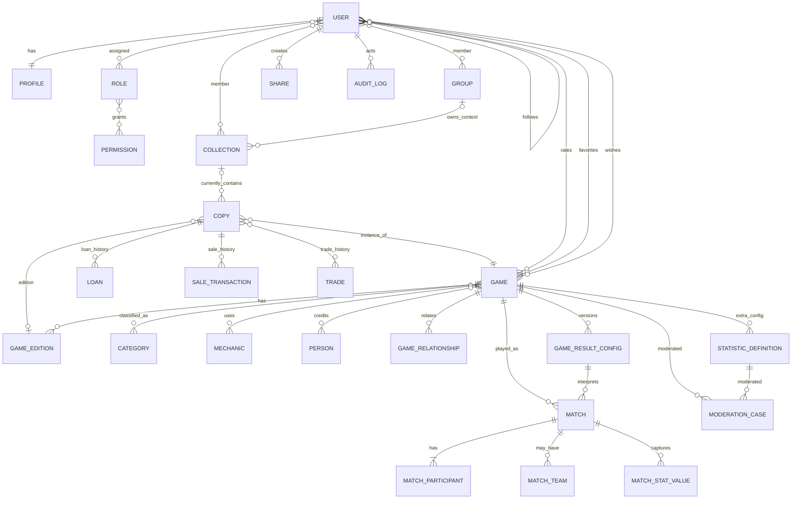

# Ludoteca Virtual — Notas del ERD lógico

**Baseline:** 16 de septiembre de 2026 — v1.1  
**Base de datos objetivo:** PostgreSQL  
**Estado:** diseño lógico detallado, previo a migraciones productivas.

## 1. Qué cubre este ERD

Este modelo traduce el documento de dominio a tablas, PK/FK, obligatoriedad y restricciones principales.

Los bloques son:

1. Identity & Access
2. Social & Groups
3. Collections
4. Game Catalog
5. Physical Copies / Inventory
6. Loans, Sales & Trades
7. Matches & Results
8. Ratings / Reviews / Wishlist
9. Sharing
10. Moderation / Merge
11. Audit

### Por qué existen catálogos de solo `code` y `name`

Tablas como `match_statuses`, `visibility_levels` y `scoring_types` son
catálogos estructurales. Sus dos campos tienen responsabilidades diferentes:

- `code`: identificador estable para FK, API y reglas de negocio, por ejemplo
  `COMPLETED`;
- `name`: etiqueta legible para interfaz, por ejemplo `Completada`.

Esto evita texto libre y valores inválidos, permite renombrar o traducir la
etiqueta sin romper el software y mantiene las semillas explícitas. Se conservan
como tablas porque son valores compartidos y referenciados por varias entidades;
no representan módulos complejos adicionales.

## 2. Decisiones importantes incorporadas

### Copia física y salida de la colección

`Copy` no se elimina cuando deja de pertenecer a una ludoteca.

Una copia:

- `ACTIVE`: está actualmente en una ludoteca del sistema.
- `EXITED`: salió de la posesión administrada por el sistema.

El motivo de salida se guarda aparte:

- `SOLD`
- `TRADED`
- `GIFTED`
- `DONATED`
- `LOST`
- `DISCARDED`
- `DAMAGED`
- `OTHER`

Esto evita confundir un evento histórico con el estado actual.

La combinación se protege con una restricción:

- `ACTIVE` exige una colección actual y prohíbe motivo de salida;
- `EXITED` exige que no haya colección actual y obliga a indicar el motivo.

Una copia con préstamo activo no puede completar una transferencia, venta,
trueque, regalo, donación, descarte o salida. Si se pierde durante el préstamo,
el préstamo se cierra como perdido y la copia pasa a `EXITED / LOST`.

#### Venta interna

Si el comprador tiene una ludoteca dentro del sistema:

```text
Copy ACTIVE
Collection A
    ↓ SaleTransaction
Collection B
Copy sigue ACTIVE
```

#### Venta externa

Si el comprador no tiene cuenta/ludoteca:

```text
Copy ACTIVE
Collection A
    ↓ SaleTransaction
current_collection_id = NULL
lifecycle = EXITED
exit_reason = SOLD
```

Las partidas históricas permanecen.

### Acquisition es histórica

`Copy` mantiene su identidad física aunque cambie de propietario dentro del
sistema. Por eso una copia puede tener varias filas en `acquisitions`.

Ejemplo:

```text
2024: Copy X adquirida por Santiago mediante PURCHASE
2026: Santiago vende Copy X a Laura
2026: Copy X adquirida por Laura mediante PURCHASE
```

Mover la copia entre dos ludotecas del mismo propietario no crea una nueva
adquisición.

---

## 3. Permisos

Se utiliza RBAC global:

```text
User
  ↓
UserRole
  ↓
Role
  ↓
RolePermission
  ↓
Permission
```

Ejemplo:

```text
moderation.approve
```

Pero RBAC no sustituye el ownership.

Una autorización real debe evaluar:

```text
permission + access_to_specific_resource
```

Ejemplo:

```text
collection.update
+
ser OWNER/MANAGER de esa Collection
```

Ser amigo por Follow mutuo nunca concede acceso privado.

### Alcance de visibilidad

`GROUP` siempre debe identificar el grupo concreto que delimita el acceso.
Por eso los recursos extensibles del catálogo tienen `scope_group_id` y las
partidas/estadísticas grupales tienen su `group_id`.

En recursos donde `GROUP` no tiene significado propio, como `Profile`,
`Group` y `Review`, el ERD solo permite `PRIVATE` o `PUBLIC`.

---

## 4. Partidas

`Match` puede existir sin `Copy`.

Esto permite registrar partidas jugadas en:

- una tienda;
- casa de un amigo;
- un evento;
- un juego prestado;
- cualquier otro contexto.

`copy_id` y `game_edition_id` son opcionales.

### Estados

- `COMPLETED`
- `INCOMPLETE`
- `CANCELLED`

Una partida `INCOMPLETE`:

- sí cuenta como partida jugada;
- no exige ganador;
- no produce automáticamente victoria/derrota.

`CANCELLED` se reserva para una partida anulada que no debe contarse como una sesión normal.

---

## 5. Modelo de resultados

La configuración base de un juego está versionada en `game_result_configs`.

Dimensiones:

- result type;
- scoring type;
- score direction;
- winner resolution;
- ties;
- score required.

Ejemplo conceptual de Flip 7:

```text
result_type       = INDIVIDUAL_WINNER
scoring_type      = POINTS
score_direction   = HIGHER_IS_BETTER
winner_resolution = MANUAL
score_required    = true
```

La aplicación registra el resultado **final de la partida**, no sus rondas internas.

Cada partida referencia exactamente la versión utilizada mediante
`matches.result_config_id`. Solo puede existir una versión vigente por juego.
Una versión ya utilizada no cambia semánticamente: si las reglas cambian, se
crea la versión siguiente y se retira la anterior. Esto evita reinterpretar
partidas históricas con reglas nuevas.

---

## 6. Estadísticas específicas por juego

`statistic_definitions` permite configurar datos que no forman parte del modelo universal.

Ejemplo Catan:

```text
Ore     INTEGER PARTICIPANT
Wool    INTEGER PARTICIPANT
Grain   INTEGER PARTICIPANT
Lumber  INTEGER PARTICIPANT
Brick   INTEGER PARTICIPANT
```

Los valores terminan en `match_stat_values`.

El mismo mecanismo permite:

```text
BOOLEAN
DECIMAL
TEXT
OPTION
```

y destinos:

```text
MATCH
PARTICIPANT
TEAM
```

### Extensiones privadas

Una estadística inventada por un usuario puede permanecer `PRIVATE`.

Puede usarse en sus partidas sin formar parte de la configuración pública de Catan.

Para convertirse en configuración global deberá pasar moderación.

Una definición ya utilizada tampoco cambia de tipo o significado. Debe
archivarse y reemplazarse por otra definición cuando la semántica cambie.

Este patrón implementa la regla:

> Los usuarios pueden extender su experiencia privada sin contaminar el dominio global.

---

## 7. Moderación

`moderation_cases` puede apuntar inicialmente a:

- Game
- StatisticDefinition
- Category
- Mechanic

`moderation_actions` conserva el historial de decisiones.

Los campos `moderation_status_code` en el recurso representan su estado actual; las acciones representan el historial.

---

## 8. Sharing

`Share` no cambia la visibilidad original.

Un juego:

```text
visibility = PRIVATE
```

puede compartirse con:

- un usuario;
- un grupo;
- un token/enlace;

sin aparecer en búsqueda global.

---

## 9. Datos derivados sin tabla primaria

No se crean tablas fuente para:

- Friendship: se deriva del Follow mutuo.
- Calendar: se deriva de `matches.started_at`.
- Rating global: se deriva de `ratings`.
- Most played: se deriva de `matches`.
- User preferences: inicialmente se infieren.
- Recommendations: inicialmente se consideran una capacidad/servicio derivado.
- Global statistics: se calculan desde datos elegibles.

Más adelante se pueden añadir materialized views, caches o snapshots.

### Ratings y reviews

- El rating usa escala decimal inclusiva de `1.00` a `10.00`.
- Cada usuario puede tener un solo rating por juego y actualizarlo.
- Cada usuario puede tener una sola review por juego y editarla con el tiempo.
- Rating y review siguen siendo independientes.

### Ludotecas destinadas a venta

Mover una copia a una colección con `is_for_sale = TRUE` crea, si no existe,
un `SaleListing` en estado `DRAFT`. En borrador, precio y moneda pueden faltar;
son obligatorios para activar la publicación.

---

## 10. Reglas que deliberadamente no se resuelven únicamente con FK/CHECK

Hay invariantes que requieren una transacción de dominio o servicio:

- una ludoteca no puede quedarse sin OWNER;
- un grupo no puede quedarse sin OWNER;
- `Match` debe respetar `Game.min_players/max_players`;
- `Match.game_edition_id` debe pertenecer a `Match.game_id`;
- `Match.copy_id` debe corresponder al juego registrado;
- las expansiones dependientes requieren base;
- StatisticDefinition y MatchStatValue deben coincidir en tipo/target;
- una venta interna debe mover la misma Copy;
- una venta externa debe sacar la Copy de la colección;
- mover una Copy debe actualizar atómicamente su colección actual, historial y
  auditoría;
- una Copy con préstamo activo no puede transferirse ni salir;
- una colección de venta genera el borrador de publicación correspondiente;
- una configuración de resultados usada es inmutable y se versiona;
- una definición estadística usada no cambia de tipo o semántica;
- Trade solo transfiere en `COMPLETED`;
- Share nunca cambia Visibility;
- una definición privada no entra en estadísticas/configuración global.

Estas validaciones pertenecen al servicio de dominio, normalmente dentro de una transacción PostgreSQL.

---

## 11. Diagrama conceptual resumido



El SQL contiene más detalle que este diagrama resumido.

---

## 12. Datos semilla

Se separan en tres familias:

### System seeds

Obligatorios:

- estados;
- visibilidad;
- roles;
- permisos;
- result/scoring types;
- statistic value types;
- transaction states;
- etc.

Archivo: `ludoteca_virtual_seed_system.sql`

### Catalog seeds

Contenido inicial, separado del sistema:

- Categories;
- Mechanics;
- Publishers;
- Games.

Todavía no se incluyen porque conviene definir su fuente y estrategia de curaduría antes de cargar información real.

### Development seeds

Solo para DEV/QA:

- usuarios ficticios;
- grupos;
- ludotecas;
- copias;
- partidas;
- préstamos;
- ventas;
- ratings.

No deben ejecutarse en producción.

---

## 13. Próximo paso recomendado

Antes de convertir este baseline en migraciones productivas:

1. Definir la arquitectura modular del backend y el stack de implementación.
2. Definir reglas de eliminación/archivo por entidad.
3. Aplicar la generación UUID y timestamps definida en ADR-003. **Resuelto.**
4. Definir estrategia de archivos/imágenes.
5. Diseñar transacciones críticas:
   - move copy;
   - sale;
   - trade;
   - loan return;
   - match creation;
   - moderation;
   - merge.
6. Crear migración `001_initial_schema.sql`.
7. Crear seeds de sistema idempotentes.
