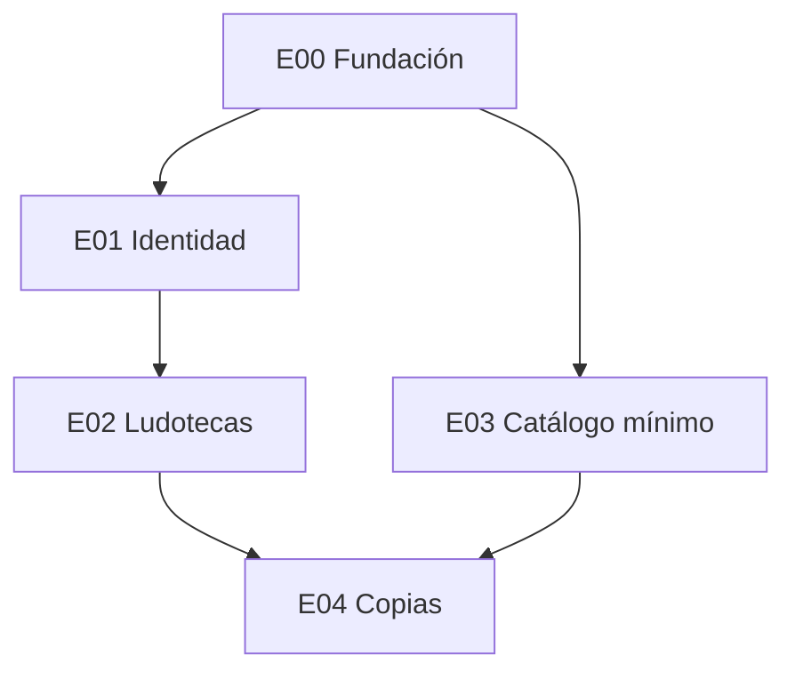

# Ludoteca Virtual — Plan Maestro de Desarrollo

**Estado:** Baseline de planificación v1.2  
**Fecha:** 21 de septiembre de 2026  
**Alcance detallado:** Fundación técnica y primera vertical funcional  
**Ejecución actual:** Desarrollo local; sin hosting ni despliegue productivo

## 1. Propósito

Este documento organiza el desarrollo de Ludoteca Virtual en épicas, features e
historias pequeñas y trazables. Es el índice maestro para trabajo humano o
mediante agentes.

No reemplaza:

- `ludoteca_virtual_dominio_reglas.md`;
- `ludoteca_virtual_erd_postgresql.sql`;
- `ludoteca_virtual_arquitectura_aplicacion.md`;
- los ADR técnicos vigentes.

Las historias implementan esas decisiones; no pueden modificarlas
silenciosamente.

---

## 2. Alcance de la primera entrega

La primera entrega demostrará esta vertical:

```text
Usuario → Ludoteca personal → Juego de catálogo → Copia física → Movimiento
```

Al terminar, un usuario autenticado deberá poder:

1. acceder localmente a la aplicación;
2. consultar y actualizar su perfil;
3. crear y consultar ludotecas personales;
4. consultar un catálogo mínimo de juegos;
5. registrar una copia física;
6. consultar sus copias;
7. mover una copia entre sus ludotecas;
8. conservar el historial y la auditoría del movimiento.

### Fuera de alcance de esta entrega

- hosting y despliegue;
- dominio público y DNS;
- servicios de correo;
- almacenamiento definitivo de imágenes;
- grupos y ludotecas grupales;
- follows y amistad;
- préstamos;
- ventas y publicaciones;
- trueques;
- partidas, resultados y estadísticas;
- ratings, reviews, favoritos y wishlist;
- Share;
- moderación y merges;
- recomendaciones;
- notificaciones.

Los campos o tablas necesarios para compatibilidad futura pueden existir, pero
no deben fingirse features incompletas en la interfaz.

---

## 3. Entorno local

Durante esta etapa:

- Next.js se ejecutará localmente mediante npm scripts;
- Express se ejecutará localmente mediante npm scripts;
- PostgreSQL será accesible mediante `DATABASE_URL` local;
- no se configurará infraestructura cloud;
- no se agregarán secretos reales al repositorio.

Convención inicial:

```text
Web: http://localhost:3000
API: http://localhost:3001/api/v1
```

PostgreSQL 18 se instalará directamente en Windows para el desarrollo local.
La API seguirá dependiendo únicamente de `DATABASE_URL`, por lo que esta
elección no impide usar posteriormente otra instancia o infraestructura.

---

## 4. Jerarquía del trabajo

```text
Roadmap
└── Épica
    └── Feature
        └── Historia
            └── Criterios de aceptación y pruebas
```

### Épica

Objetivo funcional o técnico amplio con valor identificable.

### Feature

Capacidad cohesionada dentro de una épica.

### Historia

Unidad pequeña de trabajo asignable a un agente. Debe poder implementarse,
probarse y revisarse sin abarcar un módulo completo.

---

## 5. Estados

| Estado | Significado |
|---|---|
| `PROPOSED` | Identificada, pero aún no suficientemente definida |
| `BLOCKED` | Clara, pero depende de una decisión o historia pendiente |
| `READY` | Cumple Definition of Ready y puede asignarse |
| `IN_PROGRESS` | Existe un responsable trabajando en ella |
| `REVIEW` | Implementada y pendiente de revisión/validación |
| `DONE` | Cumple criterios y Definition of Done |

Ningún agente comienza una historia `PROPOSED` o `BLOCKED`.

---

## 6. Mapa de épicas

| ID | Épica | Nivel de detalle actual | Estado |
|---|---|---:|---|
| `E00` | Fundación técnica local | Historias detalladas | `DONE` |
| `E01` | Identidad, perfil y acceso | Historias detalladas | `DONE` |
| `E02` | Ludotecas personales | Historias detalladas | `DONE` |
| `E03` | Catálogo mínimo de juegos | Historias detalladas | `DONE` |
| `E04` | Copias físicas y movimientos | Historias detalladas | `DONE` |
| `E05` | Grupos y relaciones sociales | Roadmap | `PROPOSED` |
| `E06` | Préstamos | Roadmap | `PROPOSED` |
| `E07` | Ventas | Roadmap | `PROPOSED` |
| `E08` | Trueques | Roadmap | `PROPOSED` |
| `E09` | Partidas, resultados y estadísticas | Roadmap | `PROPOSED` |
| `E10` | Ratings, reviews, favoritos y wishlist | Roadmap | `PROPOSED` |
| `E11` | Sharing y privacidad avanzada | Roadmap | `PROPOSED` |
| `E12` | Moderación y merges | Roadmap | `PROPOSED` |
| `E13` | Estadísticas, calendario y recomendaciones | Roadmap | `PROPOSED` |
| `E14` | Archivos, imágenes y recursos | Roadmap | `PROPOSED` |

---

## 7. Dependencias de la primera vertical



Dentro de una épica, el archivo correspondiente define el orden exacto.

---

## 8. Hitos

### M0 — Repositorio ejecutable localmente

Incluye E00.

Resultado:

- `npm ci` funciona desde la raíz;
- API y web arrancan localmente;
- contratos compartidos compilan;
- API se conecta a PostgreSQL;
- migraciones y seeds tienen un flujo verificable;
- health checks y manejo base de errores funcionan;
- existe una base de pruebas y calidad.

### M1 — Identidad funcional

Incluye E01.

Resultado:

- usuario autenticable según el ADR correspondiente;
- sesión validada en Express;
- perfil separado de cuenta;
- roles y permisos básicos disponibles;
- UI mínima de acceso y perfil.

### M2 — Ludoteca personal

Incluye E02 y la parte de catálogo necesaria de E03.

Resultado:

- crear y consultar ludotecas personales;
- ownership consistente;
- consulta de juegos disponibles.

### M3 — Primera vertical completa

Incluye E04.

Resultado:

- registrar, consultar y actualizar copias;
- mover una copia de forma transaccional;
- conservar historial y Audit Log;
- recorrido E2E desde Next.js.

---

## 9. Orden recomendado para agentes

El primer trabajo asignable será:

```text
E00-ST01 — Crear el esqueleto del monorepo con npm workspaces
```

Después:

```text
E00-ST02 — Crear packages/contracts
E00-ST03 — Crear el bootstrap de Express
E00-ST04 — Crear el bootstrap de Next.js
```

Estas tres historias pueden desarrollarse después de ST01. Si trabajan varios
agentes, cada uno debe tener ownership de rutas distintas y no modificar el
`package-lock.json` simultáneamente sin coordinación.

Hasta estabilizar M0 se recomienda integrar una historia antes de iniciar otra
que toque configuración raíz.

---

## 10. Decisiones que bloquean historias

| Gate | Decisión pendiente | Bloquea |
|---|---|---|
| `G01` | Autenticación y gestión de sesión | Registro, login, logout y sesión |
| `G02` | **RESUELTO:** Vitest, Testing Library, ESLint flat config y Prettier según ADR-004 | No bloquea; gobierna E00-ST09 |
| `G03` | **RESUELTO:** PostgreSQL 18 instalado localmente en Windows | No bloquea; documentado en la guía de inicialización |
| `G04` | **RESUELTO:** UUID v4 generados por PostgreSQL y `TIMESTAMPTZ(3)` según ADR-003 | No bloquea; gobierna la primera migración |
| `G05` | Estrategia OpenAPI | Publicación automática del contrato; no bloquea endpoints iniciales |

Un agente no elige por su cuenta una alternativa para cerrar un gate. Debe
recibir la decisión o una historia explícita de investigación/ADR.

---

## 11. Roadmap posterior resumido

### E05 — Grupos y relaciones sociales

Grupos, miembros, roles de grupo, ownership y follows.

### E06 — Préstamos

Préstamos internos/externos, devolución, vencimiento, pérdida y bloqueo de
transferencias.

### E07 — Ventas

Ludotecas de venta, listing en borrador, publicación, reserva, venta interna y
venta externa.

### E08 — Trueques

Propuesta, aceptación, cancelación, finalización y transferencia atómica.

### E09 — Partidas

Configuración de resultados versionada, participantes registrados/invitados,
equipos, resultados finales y estadísticas específicas.

### E10 — Contenido social

Rating decimal `1–10`, review única editable, reacciones, comentarios,
favoritos y wishlist.

### E11 — Sharing

Acceso directo, por grupo o token sin modificar visibilidad.

### E12 — Moderación

Casos, acciones, publicación global, duplicados y merges auditables.

### E13 — Datos derivados

Estadísticas, calendario y recomendaciones construidas desde datos fuente.

### E14 — Archivos

Imágenes y recursos externos con política de almacenamiento y seguridad.

Estas épicas deberán detallarse cuando se acerquen a ejecución. No deben ser
asignadas usando únicamente este resumen.

---

## 12. Archivos detallados

- `ludoteca_virtual_guia_trabajo_agentes.md`
- `ludoteca_virtual_guia_inicializacion_repo.md`
- `ludoteca_virtual_epica_00_fundacion_tecnica.md`
- `ludoteca_virtual_epica_01_identidad_acceso.md`
- `ludoteca_virtual_epica_02_ludotecas_personales.md`
- `ludoteca_virtual_epica_03_catalogo_minimo.md`
- `ludoteca_virtual_epica_04_copias_movimientos.md`

---

## 13. Criterio de éxito de la planificación

El plan es útil si un agente puede responder antes de editar:

1. qué problema resuelve;
2. qué archivos puede tocar;
3. qué reglas debe respetar;
4. de qué historias depende;
5. qué comportamiento debe demostrar;
6. qué pruebas debe ejecutar;
7. qué está explícitamente fuera de alcance;
8. cuándo debe detenerse y pedir una decisión.

Si una historia no permite responder esas preguntas, todavía no está `READY`.
